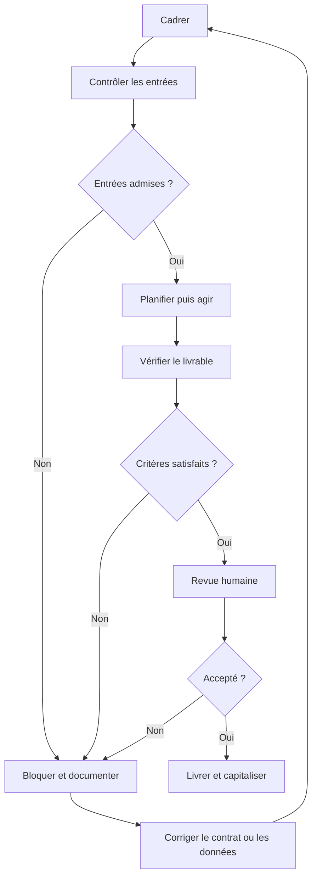

# Architecture du pack LN-IA

Version 1.0 · 10 novembre 2026 · Choix d’implémentation

## Décision

Vite, JavaScript en modules et Bootstrap constituent le socle. Une interface sans framework applicatif réduit le nombre de concepts à apprendre. La logique de production est isolée dans un module pur, testable sans navigateur. Les contenus pédagogiques sont dans un JSON distinct.

Le pack ne cherche pas à créer une infrastructure multi-agent. Le sujet de l’atelier est la délégation vérifiable. Un agent unique avec des outils limités suffit au premier MVP supervisé. Plusieurs agents ne deviennent utiles que si des sous-tâches distinctes et une méthode de coordination justifient leur coût.

## Arborescence et responsabilités

| Chemin | Fonction | Quand le modifier |
|---|---|---|
| `DEMARRER-ICI.md` | Entrée commune du formateur et du participant | Installation ou déroulement change |
| `PROMPT-MAITRE-CODEX.md` | Lancement d’une mission dans VS Code | Méthode de délégation change |
| `AGENTS.md` | Règles applicables dans le dépôt | Conventions ou périmètre change |
| `index.html` | Document sémantique et métadonnées SEO | Identité ou description change |
| `vite.config.js` | Build, URL publique et fichiers SEO | Publication ou construction change |
| `src/main.js` | Navigation et interactions du support | Une activité ou un écran change |
| `src/styles.css` | Identité LN-IA, responsive, présentation et impression | Lisibilité ou composition change |
| `src/domain/production.js` | Machine à états de la simulation | Une règle d’exécution change |
| `contenus/atelier.json` | Modules, slides, quiz, cartes et classification | Un contenu pédagogique change |
| `missions/` | Contrats M01 à M04 | Un nouveau besoin est cadré |
| `.agents/skills/` | Quatre procédures de projet | Une méthode éprouvée évolue |
| `agents/` | Fiches de responsabilités | La coordination change |
| `workflows/` | Description du cycle et de ses retours | Le processus change |
| `schemas/` | Contrats de structure documentaires | Un format d’échange change |
| `fixtures/` | Données fictives et exemples corrigés | Un exercice change |
| `tests/` | Tests des règles de livraison et de contrôle | Un comportement critique change |
| `scripts/` | Build, contrôle et démonstration | Un contrôle automatisable change |
| `docs/` | Dossier pédagogique et technique | La méthode ou les usages évoluent |
| `livrables/` | Résultats des missions et journaux d’exemple | Une exécution a lieu |
| `.github/` | Contrôle continu et formulaires d’issues | Le projet est suivi sur GitHub |
| `public/` | Logo et ressources distribuées | Les ressources changent |
| `references/` | Dossier prospectif fourni par l’utilisateur | Une nouvelle référence est ajoutée |
| `dist/` | Site compilé prêt pour un hébergement statique | Régénéré par build |
| `APERCU-AUTONOME.html` | Support autonome avec tout le nécessaire intégré | Régénéré par build |

Les scripts de build recopient les documents dans `public/ressources/`. La source reste dans `docs/` et à la racine. Éviter de modifier les copies compilées.

## Cycle fondamental proposé

Le cycle est une méthode de cet atelier, pas une norme universelle ni un protocole externe certifié.

Dans l’interface, les huit étapes restent visibles séparément. Un blocage termine l’exécution. La reprise consiste à corriger le contrat ou les données et créer une nouvelle exécution en conservant l’ancien journal. Il n’existe pas de boucle automatique illimitée.

## Frontières de confiance

Le navigateur affiche les données et exécute les règles pédagogiques. Toute personne disposant de ses outils de développement peut modifier l’état du client. Les contrôles du laboratoire servent à apprendre le processus. Ils ne constituent pas une protection pour un système multi-utilisateur.

Le corpus ne commande pas les outils. Le moteur ne dispose d’aucun outil réseau. Les deux permissions de démonstration sont la lecture du corpus et la rédaction du brouillon. Les exports déclenchent un téléchargement demandé par l’utilisateur.

Codex est un environnement d’exécution distinct. Ses autorisations réelles dépendent du poste et de sa configuration. `AGENTS.md` et `SKILL.md` donnent des instructions. Ils ne créent pas une isolation système.

## Extension future vers un agent connecté

Une future version séparerait le navigateur du serveur d’exécution. Le serveur authentifierait le demandeur, validerait le contrat, fournirait seulement les outils autorisés et contrôlerait budgets, durée et accès. Il conserverait les journaux et les versions des données. Les clés et appels modèles resteraient côté serveur.

La file de missions devrait gérer annulation, reprise et idempotence. Les actions à effet externe demanderaient un contrôle de permission juste avant l’action. L’agent proposerait une action, le serveur déciderait si elle peut s’exécuter. La validation finale serait une décision authentifiée. Ces fonctions ne sont pas livrées dans le MVP 0.

## Choisir ce que l’on automatise

| Besoin | Choix de départ |
|---|---|
| Règles stables et format fixe | Script déterministe |
| Étapes stables avec rédaction ou classement | Workflow avec étape LLM et contrôles |
| Chemin variable nécessitant outils et adaptation | Agent outillé avec budget et revue |
| Sous-problèmes indépendants avec expertises distinctes | Coordination d’agents après comparaison avec un seul agent |

La comparaison porte sur le temps total, le coût complet, le nombre de reprises et le taux de livrables acceptés selon la même grille.
